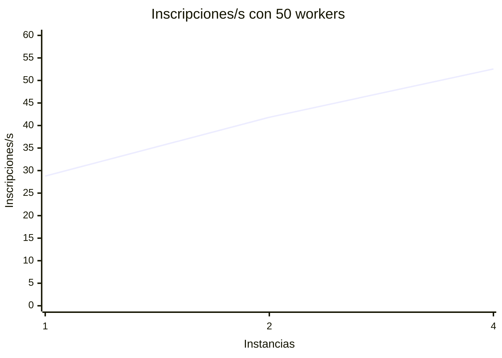
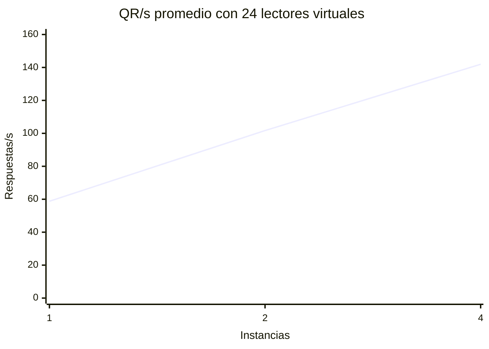

# Resultados comparativos

Fuente procesable: `evidencia/capacity-certified-summary.csv`. Cada punto certificado tiene tres ejecuciones frescas.

El punto 1×50 se observó una vez; para la capacidad certificada de una instancia se usa 1×25 repetido. El punto 4×100 se repitió tres veces, pero su variabilidad hizo fallar los SLO.
